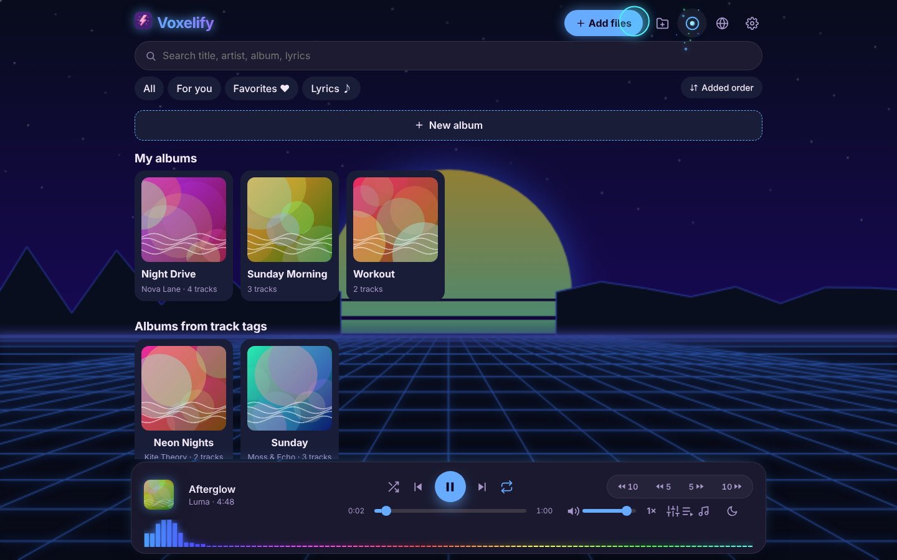
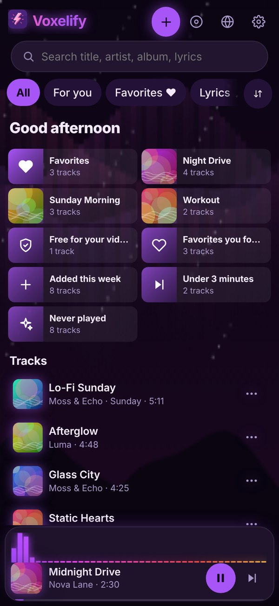
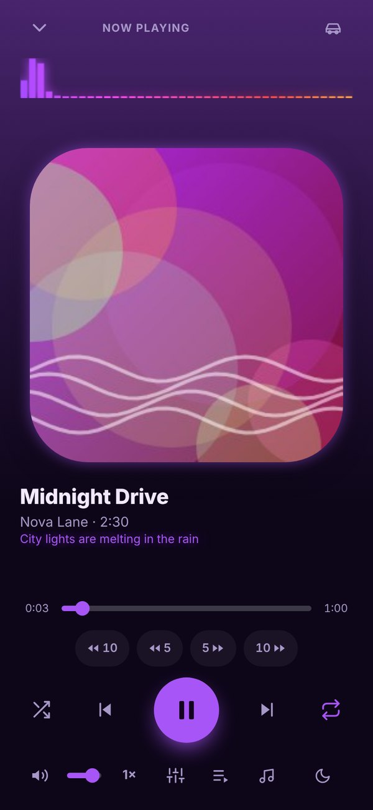
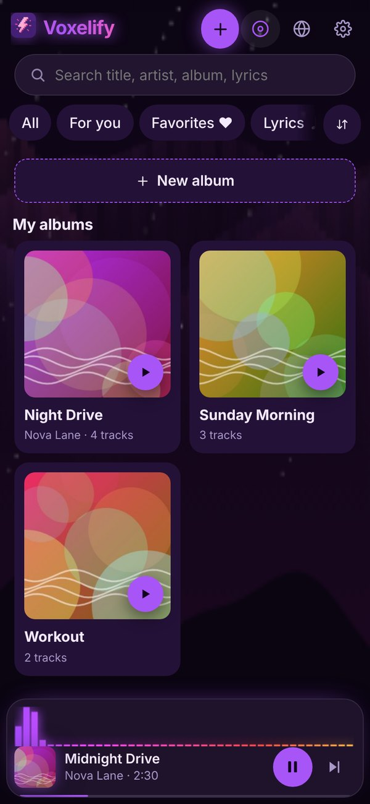
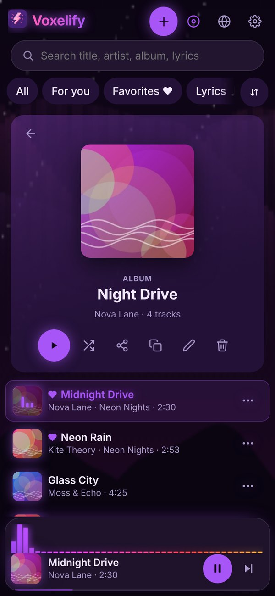
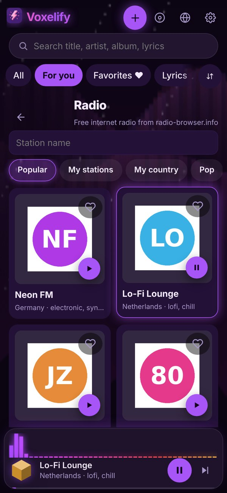
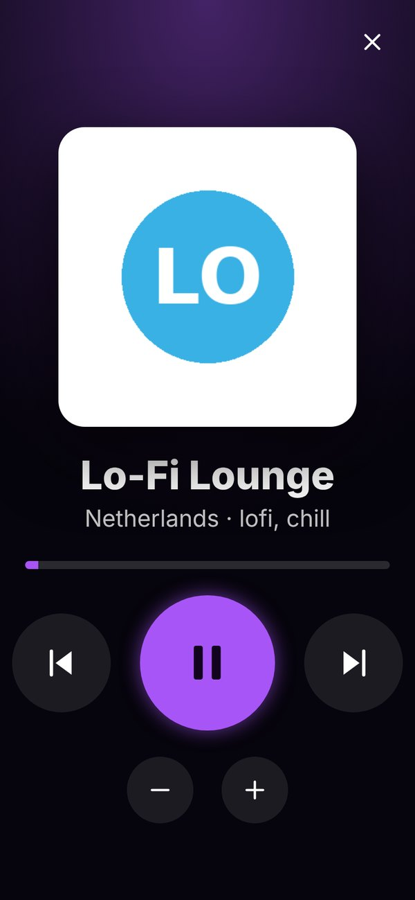
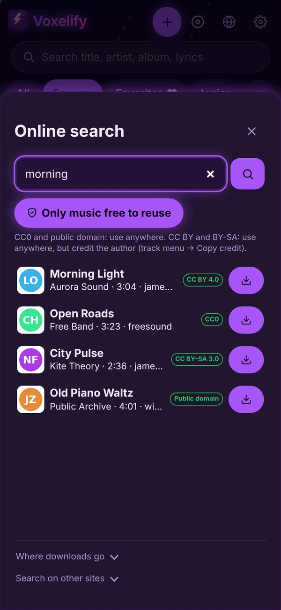
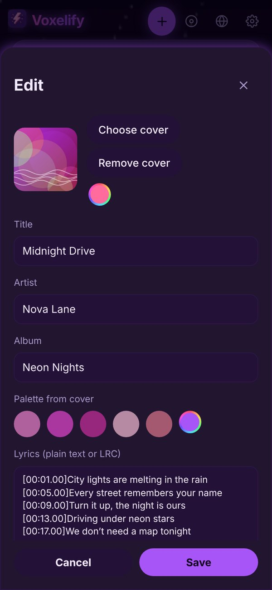

# Voxelify ⚡ · `v1.2`

**Your music. Your neon. No ads, no subscriptions, no price tag.**

Voxelify is a free music player that lives in your browser and looks like nothing else on your phone. Add your own mp3 or mp4 files, listen to free music from the internet, make the app look the way you like, and listen together with friends.

### ▶ [Open Voxelify](https://Wisper-2010.github.io/Voxelify/)

## Install it

- **Android (Chrome):** open the link, then Settings (⚙) in Voxelify → **Install app**, or ⋮ → **Install app**.
- **iPhone (Safari):** open the link, tap Share → **Add to Home Screen**.
- **Computer (Chrome or Edge):** open the link and click the install icon at the right of the address bar. On Windows you can also download this folder and double-click `app.bat`.

Then tap **Add files** and pick music. It works without internet after the first visit.

## What you can do

**Listen**
- Your own mp3 and mp4 files (from video only the sound plays), albums like in Spotify, favorites, smart playlists, a queue.
- **Free music without copyright worries:** one search over Audius, Openverse and the Internet Archive; “Only music free to reuse” shows license badges and copies the credit line for your video.
- **Music published by people on Voxelify** (see “Publish your music” below). Like tracks ♥, follow people and get their new tracks at the top of “For you”. Share a profile or a track with a link.
- **Friends, chats and calls.** Add friends, send messages, stickers, photos, voice messages and files (up to 5 MB), and call them (voice). In a listening room, join the voice chat.
- **Your music on all your devices.** Profile → My devices: see what plays on your phone or computer, pause it, or continue it here from the same second.
- **Colors your way.** Pick the outline and interface colors, and turn the neon glow on or off.
- **Your own background.** Settings → Look → Your own background: 16 kinds and ready-made sets, your colors; share it in the gallery, or use one made by someone else.
- **Profile styles:** a status, name effects and fonts, card patterns, avatar shapes, covers, frames and stickers, and up to 3 badges next to your name.
- **Internet radio:** tens of thousands of stations.
- **“For you”:** pick the genres you like and get a stream of free music.
- **Listen together:** create a room, send the link, and friends hear the same music at the same moment on their own devices. Chat, hearts, track requests.

**Sound**
- Equalizer, volume leveling, boost, speed 0.1–16×, real crossfade, sleep timer.
- **Slowed + reverb, Nightcore and 8D** with one tap (Settings → General or the Sound window).
- Ringtone cutter, voice commands, a mini player over other windows (on a computer), playlists by tempo (Running, Workout, Calm).

**Look**
- Over 100 themes (Settings → Appearance → Ready-made styles), any neon color, rainbow neon. Profiles with a check mark can also use their own picture or video as a background.
- **11 animated backgrounds that move to the beat:** fire, water, rain, snow, forest, space, aurora, sakura, synthwave (a night drive with palms and a sunset), matrix, lava lamp, each in 3 variants and full of little details.
- **Secrets** are hidden in the app. Find them to unlock profile covers, stickers and avatar frames.
- **Visualizer:** 7 kinds, your own height and sensitivity.
- **Guide book:** how everything works, in Profile and Settings, in all 11 languages.
- Winter mood (snow and a garland) from December 15 to January 15.

**Profile**
- Tap the round button at the top. Create a profile with an **@username** and a name (up to 20 characters), pick a photo, a cover, a frame and stickers, and collect badges.
- Sign in with **Google** or with an **e-mail and password** to keep your profile on all your devices, so friends can find you by @username and you can publish music. A profile made only on the device stays on that device.
- The **⋯** button in the profile: Edit, Profile settings, Switch account, Sign out.
- A blue check mark means a **verified profile**. The glowing heart seal means the person **knows the founder**. The shield belongs to the Voxelify team.

**Every day**
- Alarm with your own music, focus timer, car mode, synced lyrics, a track editor (title, artist, cover, lyrics), backup of the whole library in one file.
- 11 languages: English, Русский, Français, 中文, 日本語, 한국어, Español, Nederlands, Հայերեն, ქართული, العربية.

## Publish your music

It is free:

1. Upload the track to **Audius** or the **Internet Archive** (both free).
2. In Voxelify open your profile (it must be linked to Google or e-mail) → **Upload a track**, paste the link, add a title, a genre and a cover.
3. People find it in the search, in “For you” (New on Voxelify, Popular on Voxelify) and on your profile. They can like it and follow you; your profile shows followers and likes. You choose whether listeners may save the track to their library.

Only publish music you made or have the rights to. Anyone can report a track; someone else's music is removed and the profile may be banned.

## Privacy

- Your music files stay on your device and are never uploaded.
- Network features are used only when you use them: the online music search and radio, lyrics search, listening rooms (devices connect directly), and the profile in the cloud if you sign in.
- Public: your profile, published tracks, likes and follows. Chats are stored in the cloud and are not end-to-end encrypted.
- Settings → Privacy can delete your history or **all data**. Deleting all data also deletes profiles that are not linked to Google or e-mail; linked profiles stay in the cloud and you can sign in again.

## If something doesn't work

- **A file doesn't play:** the browser can't play that format (mkv, avi, unusual codecs). Convert it to mp3 or mp4.
- **The music disappeared:** the browser's site data was cleared. Keep your original files, or make a backup (Settings).
- **The volume slider does nothing on iPhone:** that's a Safari limit; use the phone's buttons.
- **The app looks old after an update:** close it completely and open it again.
- Questions and ideas: the Telegram button at the bottom of the list, [@wssprr](https://t.me/wssprr).

## License

The code is MIT, © 2026 Wisper, see [`LICENSE`](LICENSE). Music is not part of this license: it belongs to its authors. Voxelify only plays files you add, tracks people publish by link, and free or licensed music from public sources (Audius, Openverse, the Internet Archive, internet radio).
